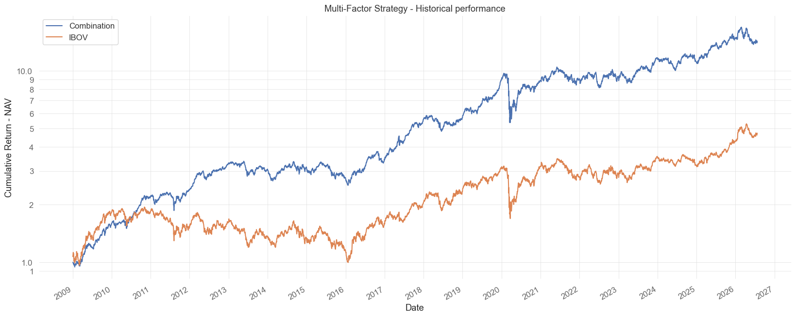

# Brazil Equity Factors

Data collection, factor construction and backtests of equity factor strategies in the Brazilian stock market, from January 2009 to July 2026.

The repository tests 32 factors one by one and combines three strategies in a long-only multi-factor portfolio. The companion repository, [magic-formula-brazil](https://github.com/pedroandion/magic-formula-brazil), studies Joel Greenblatt's Magic Formula in more depth and holds the article.



## Results

All results are before transaction costs.

### Multi-factor strategy (`05_multi_factor_strategy.ipynb`)

The Combination holds up to 30 stocks, rebalanced every month: 10 from each of the Magic Formula, LowVol Momentum and Quality. A stock picked by more than one strategy gets a larger weight.

| | Magic Formula | LowVol Momentum | Quality | Combination | Ibovespa | CDI |
|---|---|---|---|---|---|---|
| Total return | 1561.6% | 1705.9% | 438.8% | **1489.6%** | 370.6% | 420.7% |
| Annualized return | 17.4% | 18.0% | 10.1% | **17.1%** | 9.3% | 9.9% |
| Volatility | 19.6% | 19.7% | 21.9% | **19.0%** | 23.4% | 0.2% |
| Sharpe ratio | 0.44 | 0.46 | 0.12 | **0.43** | 0.09 | 0.00 |
| Maximum drawdown | -44.4% | -47.3% | -49.9% | **-45.3%** | -48.6% | 0.0% |

Regressing the Combination on the NEFIN factors gives an alpha of 0.36% per month (p-value of 3.3%), with exposures of 0.86 to the market, 0.25 to SMB, -0.08 to HML and 0.12 to WML, and an adjusted R² of 82%.

### Long-only factor trend basket (`06_factor_trend_long_only.ipynb`)

Every month, the trend index of `05_` is applied to the long leg of each of the 32 factors. The 10 factors with the best trend are chosen, and all their stocks go into one basket. A stock held by more than one chosen factor gets a larger weight. The window starts in February 2010, the first month in which a factor has a trend signal.

| | Top 10 factors (EQ10) | Top 10, only positive trends, rest in CDI | All 32 factors, no trend | 05 Combination | Ibovespa | CDI |
|---|---|---|---|---|---|---|
| Annualized return | **13.6%** | 10.9% | 8.6% | 15.7% | 6.1% | 9.9% |
| Volatility | 20.5% | 12.0% | 21.7% | 19.2% | 22.8% | 0.2% |
| Sharpe ratio | **0.27** | 0.13 | 0.06 | 0.36 | -0.04 | 0.00 |
| Maximum drawdown | -50.3% | -30.3% | -50.8% | -45.3% | -48.6% | 0.0% |
| NEFIN alpha per month (t-stat) | **0.45% (3.3)** | 0.09% (0.6) | 0.19% (1.5) | 0.54% (3.1) | | |

The legs hold the 10 stocks with the highest signal. The second column weights the 10 factors by `max(trend, 0)` and keeps the rest in the CDI. The EQ10 basket holds about 59 stocks, with an effective N of 45, a largest weight of 5.0% on average and 8.0% at its peak, and a turnover of 32% per month. The notebook also tests legs made of the top quintile, the 32 factors without the five composites, and other allocation rules.

EQ10 beats all of 500 random choices of 10 factors, whose mean is 8.5%, and its result fades slowly when the signal is lagged (11.2% with 21 days of extra lag). Its shape looks like the Combination's mostly because both buy from the same universe: EQ10 has an R² of 0.93 on the equal-weighted investable universe, and the two portfolios share only about a third of their weight. With only the five composites and the six market factors, choosing the 3 to 6 with the best trend returns 16.8% to 13.3% a year, but that number of factors was chosen in sample.

### Factor screening (`04_factor_screening.ipynb`)

Each factor is sorted into quintiles every month. The table shows the annualized mean return of the best quintile minus the worst, for the top and bottom of the ranking.

| Factor | 5Q - 1Q | p-value |
|---|---|---|
| Momentum | 16.69% | 6.67% |
| Return on Capital | 13.91% | 13.91% |
| IVOL | 10.90% | 19.33% |
| Return on Equity | 10.63% | 21.41% |
| Earnings Yield (Magic Formula) | 8.97% | 29.70% |
| ... | | |
| Investments | -3.34% | 69.28% |
| Size | -3.67% | 66.43% |
| Reversal | -11.07% | 20.83% |

None of the 32 factors is significant at the 5% level with the test used (see [Limitations](#limitations)).

### Factor portfolios (`03_historical_betas.ipynb`)

The local long-short factors have these annual mean returns: market excess 2.1%, SMB -1.1%, HML 0.2%, RMW 2.8%, CMA -2.7%, WML 11.8% and BAB 3.5%.

## Notebooks

| Notebook | What it does | Runs from this repository |
|---|---|---|
| `01_data_collection` | Collects prices, volume, index composition, benchmarks and financial statements from the Comdinheiro API | No: needs a licensed account |
| `02_factor_construction` | Builds the point-in-time indicators and the daily factor files | No: needs the raw financial statements |
| `03_historical_betas` | Builds local factors (market, SMB, HML, RMW, CMA, WML, BAB), rolling betas for four models in three windows, and idiosyncratic volatility | Yes |
| `04_factor_screening` | Tests the 32 factors by quintile and by long-short percentile | Yes |
| `05_multi_factor_strategy` | Combines three strategies and tests the number of stocks and the rebalancing schedule | Yes |
| `06_factor_trend_long_only` | Chooses the factors whose long legs have the best trend and holds them in a single basket, with its concentration | Yes |

`01` and `02` stop at their first cell with a message that explains what is missing. The functions shared by the notebooks are in the `brfactors` package.

## Method

- **Universe.** Stocks in the SMLL and MLCX indices, using their historical composition, collected in January, May and September, to reduce survivorship bias. A stock must have a price and a median traded value above R$ 1 million over the last 42 days. When a company has several tickers, only the most liquid one counts. The Magic Formula factors also exclude the sectors labeled `Financeiro`, `Financeiro e Outros` and `Utilidade Pública` by the data provider.
- **Point in time.** A financial statement enters the indicators on its publication date, or on the next trading day if it was published on a non-trading day.
- **Signals.** Daily cross-sectional z-scores. Values beyond 2 standard deviations are discarded.
- **Backtests.** Rebalancing on the first business day of each month, with equal weights. The signal is the one from the day before the rebalance, and the new weights earn returns from the next day on.

## Limitations

- **No costs.** Brokerage, stock lending and market impact are left out. They matter most for the long-short portfolios and for short rebalancing periods.
- **In-sample results.** The strategy, the parameter tests and the trend index in `05_` use the same sample, and nothing was checked out of sample. The trend index is exploratory. So is its use in `06_`, where several allocation rules were compared on the same sample.
- **Correlated factors in `06_`.** The 32 factors include five composites together with their components, so similar factors can be chosen together. The notebook measures this, and repeats the tests without the composites.
- **Statistical test.** The screening uses an unpaired t-test between the first and the fifth quintile. It ignores the correlation between them, so it tends to understate significance. There is also no adjustment for testing 32 factors.
- **Delistings.** A stock that stops trading keeps a zero return until the next rebalance.
- **Trimming.** Z-scores beyond 2 are discarded, not capped, so stocks with extreme values leave the ranking.
- **Sector labels.** The provider's `Financeiro` label is broader than GICS Financials: it also holds real estate companies and some holding companies, while other holdings, such as Bradespar, are labeled as materials. Moving a few companies in or out of the filter changes the Magic Formula results noticeably, because it shifts the rank of all the others.
- **Benchmark window in `05_`.** The Ibovespa column includes January 2, 2009 (+7.2%), before the first portfolio is invested. Without that day its total return is 339.1% and its annualized return is 8.8%, so the comparison works slightly against the strategy.
- **Sharpe ratio.** The notebooks use the mean excess return over the CDI divided by volatility. The article in the companion repository uses (CAGR - CDI) / volatility.
- **Prices and market values.** Prices are forward-filled, including after a delisting, so the beta matrices include delisted stocks with stale prices and betas near zero. The raw data has a few implausible one-day moves, such as `KLBN11` at +11,644%, on dates when those stocks were outside the investable universe. The market value of `ENEV3` is wrong from November 10 to 28, 2025, at about 45% of the market total, which touches the signals of one monthly rebalance.
- **Data vintages.** The price file of the companion repository comes from another collection, ends earlier and has gaps, and its Magic Formula uses other rules. The two repositories therefore report different numbers for strategies with similar names.

## Data

| Location | Content | Source |
|---|---|---|
| `data/` | Prices, volume, index composition, benchmarks, relative market value | [Comdinheiro](https://www.comdinheiro.com.br/) |
| `data/nefin_factors.csv.gz` | Daily factor returns | [NEFIN-USP](https://nefin.com.br/) |
| `data/ff_factors.csv.gz` | Local factor returns | Built by `03_` |
| `factors/` | Daily indicators of each factor | Built by `02_` and `03_` |

Raw financial statements and market values in R$ are licensed and are not in this repository. `relative_market_value.csv.gz` holds each stock's share of the day's total market value, which is enough for the size sorts and the size weights. The 12 beta matrices that `03_` creates are not versioned, because no notebook reads them.

To run the collection with your own account, set `COMDINHEIRO_USERNAME` and `COMDINHEIRO_PASSWORD` and keep the raw files in `data/private/`, which git ignores.

## Running the notebooks

The notebooks were run with Python 3.13.

```bash
git clone https://github.com/pedroandion/brazil-equity-factors.git
cd brazil-equity-factors
python -m venv .venv
source .venv/bin/activate    # On Windows: .venv\Scripts\activate
pip install -r requirements.txt
python -m nbconvert --to notebook --execute --inplace 04_factor_screening.ipynb
```

They do not need to run in order, because the files they read are in the repository. `03_` rewrites `data/ff_factors.csv.gz` and `factors/ivol.csv.gz`, which `04_` reads, so run it before the others or not at all. On a laptop, `03_` takes about 7 minutes, `04_` about 40, `05_` about 20 and `06_` about 6. The workflow in `.github/workflows/run-notebooks.yml` runs the four on a clean Linux machine.

## License

The code is under the [MIT License](LICENSE). The data files are not covered by it: they are included only so that the results can be reproduced, and they remain subject to the terms of their sources.

## Author

Pedro Andion de Oliveira Freitas
